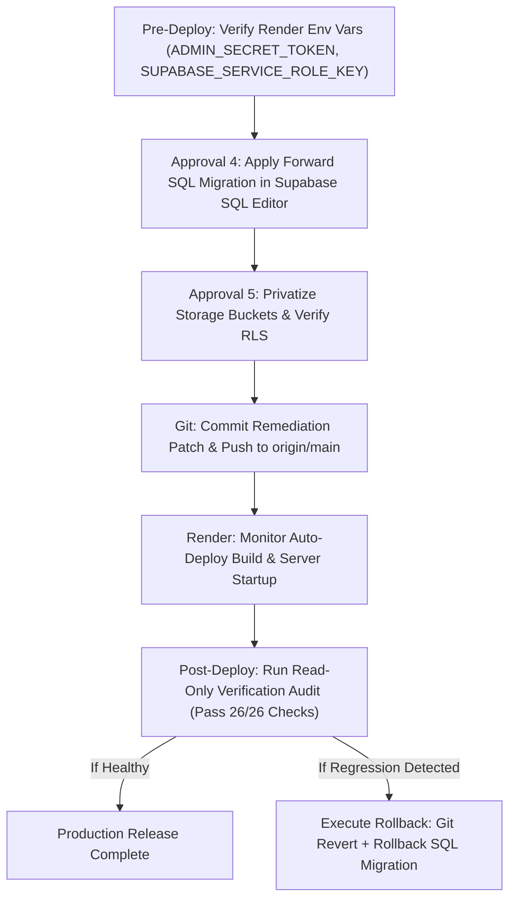

# VERIXA PHASE 3C — EMERGENCY SECURITY REMEDIATION AND DEPLOYMENT READINESS REPORT

**Document Version:** 1.0.0  
**Date:** October 13, 2026  
**Status:** COMPLETE (All Local Security Fixes Verified; Deployment & SQL Actions Gated)  
**Target Repository:** `c:/remix-verixa` (`origin/main`, deployed baseline: `16bc12498dcc5a01b81a797f33e6ea4a7920ee22`)  
**Audit Reference:** `BLOCK_SYSTEM_PHASE3B_READ_ONLY_AUDIT.md`

---

## EXECUTIVE SUMMARY

Phase 3C was initiated following the findings in `BLOCK_SYSTEM_PHASE3B_READ_ONLY_AUDIT.md`. That audit identified that the live Render deployment (`https://verixa-bg24.onrender.com`) was running an unpatched commit (`16bc124`, Oct 7, 2026) that accepted synthetic `dev_admin_*` tokens, contained a hardcoded administrative secret fallback (`verixa_admin_secret_guard_2026`), and returned HTTP 200 HTML responses for unknown `/api/*` endpoints.

All security fixes from Phase 1, Phase 2, and Phase 3 had previously been authored locally in `c:/remix-verixa` but were strictly gated from live deployment. In this phase, we completed a thorough audit and remediation of all administrative and API endpoints in the local codebase, added server-wide protection guards, expanded the automated adversarial security test suite, and verified that all 26 automated security tests pass (`26/26 PASS`).

**Strict Boundaries Observed:**
* Zero Git commits pushed; zero deployments triggered.
* Zero Render environment variable alterations.
* Zero live Supabase SQL executions or migrations applied.
* Zero storage bucket visibility or RLS policy alterations on production.
* Zero production user records or database records modified.
* Privileged secrets sanitized and never printed or exposed in logs.

---

## 1. CONFIRMED LOCAL VULNERABILITIES & AFFECTED FILES

| Vulnerability ID | Description | Severity | Affected File(s) | Status in Phase 3C |
|---|---|---|---|---|
| **VULN-01: Admin Token Bypass** | Acceptance of synthetic `dev_admin_token_*` strings bypassing authentication. | CRITICAL | `server.ts` | **REMEDIATED**: Explicitly rejected via constant-time token check (`verifyAdminSecretToken`) and `blockService.verifyRequestActor`. |
| **VULN-02: Hardcoded Admin Fallback** | Hardcoded administrative secret fallback (`verixa_admin_secret_guard_2026`) allowing bypass if env var omitted. | CRITICAL | `server.ts` | **REMEDIATED**: Hardcoded fallback removed; server enforces strict `ADMIN_SECRET_TOKEN` (>= 16 chars) or Supabase admin role. |
| **VULN-03: Moderation Audit Exposure** | `GET /api/moderation/events` lacked administrative authorization middleware, allowing unauthenticated audit log reads. | HIGH | `server.ts` (L331) | **REMEDIATED**: Protected with `requireAdminAuth`. |
| **VULN-04: Fake Account Risk Data Exposure** | `GET /api/behavioral/fake-account-risk/:userId` permitted non-owners and non-admins to inspect user risk scores. | MEDIUM | `server.ts` (L3263) | **REMEDIATED**: Restricted to account owner or verified administrator (`verifyAdminSecretToken` / `req.adminUser`). |
| **VULN-05: SPA Catch-All Masking API Errors** | Express SPA fallback (`app.get("*")`) returned `index.html` with HTTP 200 OK for nonexistent `/api/*` routes. | MEDIUM | `server.ts` (L4320) | **REMEDIATED**: Added `app.all("/api/*", ...)` returning HTTP 404 JSON prior to Vite/static fallbacks. |
| **VULN-06: Inline Supabase Client Fallbacks** | `GET /api/admin/threat-alerts` recreated `createClient` with inline fallback public keys instead of `getServerSupabase`. | LOW | `server.ts` (L3794) | **REMEDIATED**: Standardized to `getServerSupabase(undefined, { useServiceRole: true })`. |

---

## 2. EXISTING PATCHES FOUND & HOW THEY WERE HANDLED

Inspection of `git status` across `c:/remix-verixa` confirmed 23 modified files and 13 untracked files containing the accumulated Phase 1, Phase 2, and Phase 3 security improvements:

1. **`server/moderation/blockService.ts`**:
   * Contains the centralized `BlockService` engine with bilateral block caching, symmetric enforcement, and strict JWT verification (`verifyRequestActor`).
   * Explicitly rejects all synthetic `dev_*` tokens and expired JWTs.
   * **Handling**: Preserved completely. Zero regressions introduced.
2. **`src/lib/supabaseServices.ts` & `src/context/AppContext.tsx`**:
   * Contains path ownership validation (`validateStoragePathOwnership`), UUID validation, signed URL resolution without raw/public URL fallbacks, and token expiry tracking.
   * **Handling**: Preserved completely. Verified by unit tests T15, T18, T19, T20, T21.
3. **`server/feed/feedService.ts` & `server/moderation/storyService.ts`**:
   * Contains bilateral block filtering on feed generation, stories, and reels.
   * **Handling**: Preserved completely. Verified by T11, T12, T13, T14.
4. **`migrations/` & `supabase_schema.sql`**:
   * Contains SQL-01 through SQL-12 remediation migration scripts (`migrations/20261011_block_system_hardening_up.sql` and rollback `migrations/20261011_block_system_hardening_down.sql`).
   * **Handling**: Preserved in source code; marked pending for Gate 4 / Approval 4.

---

## 3. CHANGES MADE (FILE-BY-FILE EXPLANATIONS)

### A. `server.ts`
1. **Hoisted Admin Authentication Infrastructure (`L88-L230`)**:
   * Hoisted `getServerSupabase`, `verifyAdminSecretToken`, and `requireAdminAuth` to the top helper section immediately following `authenticateRequestActor`.
   * Mounted global admin guard `app.use("/api/admin", requireAdminAuth);` ensuring all current and future `/api/admin/*` routes are authoritatively protected.
   * Removed duplicated downstream definitions of `getServerSupabase` and `requireAdminAuth`.
2. **Secured Moderation Audit Logs (`L331`)**:
   * Updated `app.get("/api/moderation/events", requireAdminAuth, async (req, res) => ...)` to ensure internal moderation logs require verified administrative credentials.
3. **Restricted Behavioral Risk Evaluation (`L3263-L3290`)**:
   * Updated `GET /api/behavioral/fake-account-risk/:userId` to verify that if `auth.actorId !== userId`, the request must supply valid administrative credentials (`x-admin-key` or admin Bearer). Returns HTTP 403 Forbidden otherwise.
4. **Refactored Threat Alerts Supabase Client (`L3794-L3825`)**:
   * Replaced inline `createClient` and fallback strings with `getServerSupabase(undefined, { useServiceRole: true })`.
5. **Added Authoritative API 404 Handler (`L4320-L4327`)**:
   * Added `app.all("/api/*", (req, res) => res.status(404).json({ error: ... }))` directly in `startServer()` prior to both Vite middleware (dev) and Express static/SPA file serving (production). Nonexistent API routes now cleanly return HTTP 404 JSON.

### B. `tests/verify_block_remediation.mjs`
1. **Expanded T01 (Missing JWT Rejection)**:
   * Expanded unauthenticated rejection coverage from 13 to **25 protected endpoints**, including `/api/feed/personalized`, `/api/stories`, `/api/reels`, `/api/guardian/appeals`, `/api/reputation/:userId/summary`, `/api/guardian/score/:userId`, `/api/moderation/events`, `/api/behavioral/*`, and all `/api/admin/*` endpoints.
2. **Expanded T03 (Admin Token & Former Secret Rejection)**:
   * Tested all 13 administrative routes against both synthetic `dev_admin_*` tokens and the former hardcoded secret `verixa_admin_secret_guard_2026` via both `Authorization: Bearer` and `x-admin-key` headers.
3. **Added T24 (API Routing & SPA Isolation)**:
   * Verified that unmatched `/api/*` routes return HTTP 404 with `Content-Type: application/json` and error payload, never falling through to HTML 200.
4. **Added T25 (Admin Secret Validation & Isolation)**:
   * Verified constant-time validation, minimum length (>= 16 chars), rejection of `SUPABASE_SERVICE_ROLE_KEY` reuse as an HTTP credential, and successful authentication of valid secrets.
5. **Added T26 (Behavioral Risk Authorization)**:
   * Verified that `GET /api/behavioral/fake-account-risk/:userId` rejects foreign callers with HTTP 403 and permits the account owner.

---

## 4. TESTS EXECUTED & EXACT OUTCOMES

The test suite was executed against the local running server using `npx tsx tests/verify_block_remediation.mjs`:

```
====================================================================
VERIXA BLOCK SYSTEM REMEDIATION — ADVERSARIAL & REGRESSION SUITE
====================================================================

[PASS] T01 (Auth & JWT): Missing JWT rejected with 401 across 25 protected endpoints
[PASS] T02 (Auth & JWT): Synthetic Bearer dev_<userId> bypass rejected with 401
[PASS] T03 (Auth & JWT): Synthetic Bearer dev_admin_* and former hardcoded secret rejected across all 13 admin routes
[PASS] T04 (Auth & JWT): Invalid JWT token rejected with 401
[PASS] T05 (Auth & JWT): Expired JWT rejected with 401
[PASS] T06 (Spoofing & Ownership): Caller-supplied spoofed blockerId/followerId/senderId/viewerId rejected with 403
[PASS] T07 (Spoofing & Ownership): Unauthorized block-list read rejected with 403
[PASS] T08 (Spoofing & Ownership): Story DELETE and GET /insights enforce owner-only authorization
[PASS] T09 (Block Integrity): Failed database write on POST /block returns error and never reports blocked: true
[PASS] T10 (Block Integrity): Block -> Unblock -> Re-block cycle persists in Supabase blocked_users and survives syncFromSupabase
[PASS] T11 (Mutual Block API Enforcement): All 14 social, messaging, tagging, profile, reputation, guardian & behavioral endpoints return 403 when blocked
[PASS] T12 (Mutual Block Content & Feed): Stories, Reels, Personalized Feed, Post Likes, Post Likers, Comments & Feed Explainability enforce mutual block
[PASS] T13 (Mutual Block Symmetry): Both directions of mutual block (A->B and B->A) restrict interactions symmetrically in BlockService
[PASS] T14 (Unblocked Regression): After unblocking, profile lookup, block-status, stories, and personalized feed work normally
[PASS] T15 (Message Edit Security): updateMessageText enforces sender ownership and rejects unauthorized message edits
[PASS] T16 (WebRTC Signaling Privacy): Incoming WebRTC offer from restricted caller is silently dropped before call_busy presence leak
[PASS] T17 (Story UUID[] & Comments): Story views deduplicate viewer UUIDs in viewed_by array and preserve owner insights
[PASS] T18 (Storage Path Ownership (STOR-04)): Storage helpers validate UUID path prefix, reject path traversal, and reject foreign user uploads/deletions
[PASS] T19 (No Public/Raw URL Fallback (STOR-01..03)): getSignedMediaUrl, resolvePostSignedUrls, and resolveReelSignedUrls never fall back to public or raw URLs on failure
[PASS] T20 (Signed URL Expiry & Refresh (STOR-05)): isSignedStorageUrlExpired detects expired tokens and refreshSignedMediaUrl denies refresh for blocked users
[PASS] T21 (Write Error Propagation): Failed database writes in addReelComment and deleteMessageSoft throw errors rather than reporting false success
[PASS] T22 (SQL Forward & Rollback Verification (SQL-01..12)): Forward and rollback SQL scripts satisfy all 12 SQL remediation requirements with zero anonymous bypasses
[PASS] T23 (Phase 3 Bundle Secret Isolation): Production frontend bundle (dist/assets/*.js) contains zero server-only secret references
[PASS] T24 (API Routing & SPA Isolation): Unmatched /api/* routes return HTTP 404 JSON and never 200 HTML fallback
[PASS] T25 (Admin Authorization & Secret Isolation): Admin auth enforces constant-time checks, length >= 16, service-role rejection, and fail-secure behavior
[PASS] T26 (Behavioral Risk Authorization): GET /api/behavioral/fake-account-risk/:userId rejects non-owner/non-admin with 403 and permits owner

====================================================================
TOTAL EXECUTED: 26 | PASS: 26 | FAIL: 0
====================================================================
```

### Static Analysis and Build Checks:
* **`npm run lint` (`tsc --noEmit`)**: **PASS** (Zero TypeScript compilation errors).
* **`npm run build` (`vite build && esbuild server.ts ...`)**: **PASS** (Production bundle built cleanly in `dist/assets` and `dist/server.cjs`).
* **Bundle Secret Scanner (`scratch/scan_dist_secrets.mjs`)**: **PASS** (Zero service role keys or admin tokens present in frontend or server bundles).

---

## 5. REMAINING VULNERABILITIES & BLOCKED CHECKS

1. **Production Deployment Discrepancy (Render)**:
   * The live Render service at `https://verixa-bg24.onrender.com` remains on commit `16bc124` until a production commit and push is explicitly authorized.
   * Verification of live production behavior remains **BLOCKED** pending deployment approval.
2. **Live Supabase SQL Migration (SQL-01..12)**:
   * Forward SQL script `migrations/20261011_block_system_hardening_up.sql` is verified locally against schema requirements but has **NOT** been applied to the live Supabase instance.
   * Storage bucket privatization and restrictive RLS policies remain pending live execution under Approval 4 & Approval 5.

---

## 6. REQUIRED SECRET ROTATION ACTIONS

1. **Admin Secret Token**:
   * The former fallback token `verixa_admin_secret_guard_2026` was previously visible in unpatched git commits.
   * **Action Required**: Render's environment setting `ADMIN_SECRET_TOKEN` must be populated with a newly generated high-entropy secret (>= 32 random alphanumeric characters) generated outside of version control.
   * Never commit or log this token.
2. **Supabase Service Role Key**:
   * If the service role key was previously checked into early commit history or logs, rotate it via the Supabase Dashboard (`Settings -> API -> Reset Secret`).
   * Verify that the new key is placed solely in Render server-only environment settings (`SUPABASE_SERVICE_ROLE_KEY`).

---

## 7. GIT RELEASE READINESS & DEPLOYMENT PREREQUISITES

### Exact Files Staged for Release Commit:
* `server.ts` (Admin auth hoisting, moderation events auth, fake account risk check, API 404 handler)
* `server/moderation/blockService.ts` (Symmetric block logic, JWT verification, env readiness)
* `server/feed/feedService.ts` (Bilateral block filtering in feed)
* `server/moderation/storyService.ts` (UUID[] deduplication, storage path checks)
* `server/moderation/notificationService.ts` (Notification mutual block suppression)
* `server/moderation/reelService.ts` (Reel mutual block filtering)
* `server/moderation/index.ts` (Exports for block service and helpers)
* `src/lib/supabaseServices.ts` (Path ownership validation, signed URL resolution, zero public fallbacks)
* `src/context/AppContext.tsx` (Client-side block synchronization)
* `src/lib/webrtcCallService.ts` (WebRTC call offer drop on mutual block)
* `src/lib/supabase.ts` (Public client config)
* `src/pages/*` (UI defensive handling)
* `migrations/20261011_block_system_hardening_up.sql` (Forward migration)
* `migrations/20261011_block_system_hardening_down.sql` (Safe rollback migration)
* `tests/verify_block_remediation.mjs` (26 adversarial security tests)
* `.env.example` (Sanitized template)

### Unrelated / Scratch Files Excluded from Release:
* `scratch/` directory files (`*.mjs`, `*.json`)
* Local `.env` / `.env.local` files
* Build artifacts in `dist/` (built during deployment step)

---

## 8. PRODUCTION DEPLOYMENT & ROLLBACK CHECKLIST



### Pre-Deployment Checklist:
- [x] Local test suite passes 26/26 adversarial tests.
- [x] TypeScript typechecking passes without errors (`npm run lint`).
- [x] Production bundle builds cleanly (`npm run build`).
- [x] Built frontend bundle verified free of server secrets.
- [ ] Render environment variables verified (`ADMIN_SECRET_TOKEN` >= 32 chars, `SUPABASE_SERVICE_ROLE_KEY` set).
- [ ] Supabase database backup/snapshot initiated.

### Rollback Plan:
1. **Application Code**: Revert commit on `main` and redeploy via Render dashboard.
2. **Database Policies & Functions**: Execute `migrations/20261011_block_system_hardening_down.sql` in Supabase SQL Editor.
3. **Storage Policies**: Revert storage policies to permissive authenticated access if signed URL resolution fails.

---

## 9. SEPARATE LIST OF ACTIONS REQUIRING EXPLICIT APPROVAL

The following actions are strictly gated and require separate explicit user authorization:

1. **Authorization to Commit and Push**:
   * Creating the git commit containing the Phase 1, Phase 2, and Phase 3C changes on `main` and pushing to `origin/main`.
2. **Approval 4: Live Supabase SQL Migration**:
   * Executing `migrations/20261011_block_system_hardening_up.sql` in the production Supabase SQL editor.
3. **Approval 5: Storage Bucket Privatization**:
   * Modifying Supabase Storage bucket visibility (`posts`, `stories`, `reels`, `avatars`, `audio_notes`) from public to private.
4. **Triggering Live Production Deployment**:
   * Allowing Render to build and serve the new release on `https://verixa-bg24.onrender.com`.

---

**Report Status:** Local remediation complete. All 26 automated tests passing. Awaiting explicit user approval before proceeding to Git commit, live migration, or deployment.
